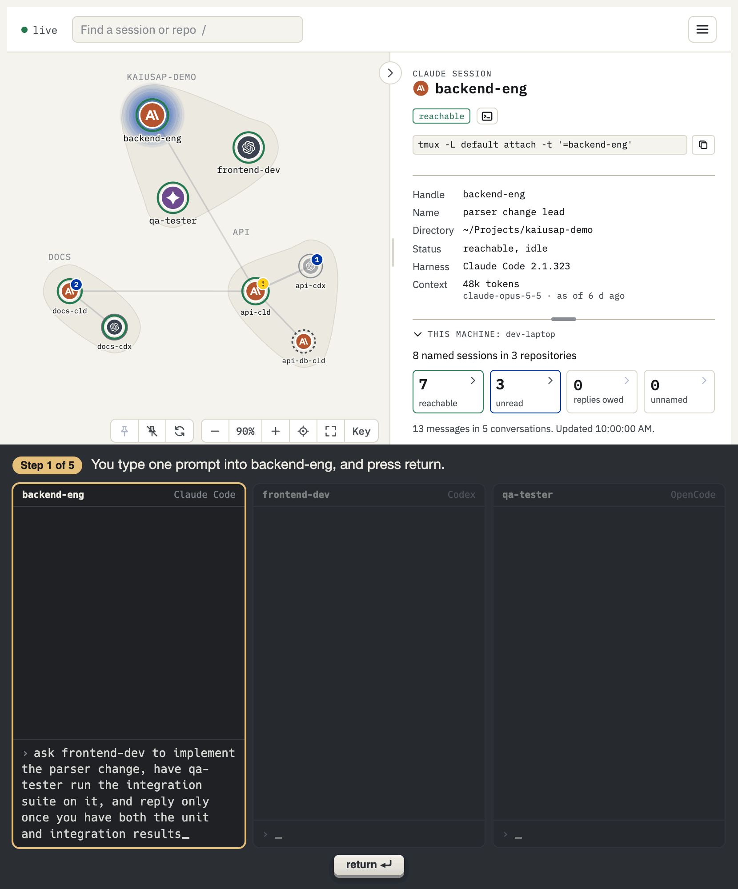
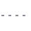

<picture>
  <source media="(prefers-color-scheme: dark)" srcset="docs/assets/kaiusap-icon-dark.svg">
  
</picture>

# kAIusap map

The kAIusap map shows, in a browser, your kAIusap sessions:

- which are running
- which repository each is working in
- which are talking to each other
- which owe a reply
- which are waiting on you

Each session is a circle, and the messages between two sessions are a line between them. From the map, you can get back to any session in a click: its terminal, or the Claude desktop app it runs in.

I built the map because I found that once more than a few sessions were talking to each other or working on coordinated tasks, it became hard to keep track of who was doing what. I also work across tmux and several terminal windows (most often Ghostty), each split into panes, so finding the right session meant tabbing through a sea of windows. I wanted one place to see them and their relationships, and to be able to bring the one I needed to the front. The map does this.

<picture>
  <source media="(prefers-color-scheme: dark)" srcset="docs/assets/map-flow-dark.gif">
  
</picture>

*Illustration: You ask backend-eng to have frontend-dev make a change, and to coordinate testing with qa-tester. frontend-dev makes the change, runs the unit tests, and asks qa-tester to run the integration tests. Every message goes through kAIusap until backend-eng reports both sets of test results back to you. The map, above, shows each message as it happens in the terminals below.*

The map only reads from kAIusap. It never reads the harnesses or sessions directly. It never sends or replies to messages, or marks them as read. kAIusap itself works the same with or without the map.

| Works with |  |
| --- | --- |
| Systems | macOS and Linux (**Show in terminal** and **Show in Claude** are macOS only, for now) |
| Harnesses | Every harness kAIusap supports: Claude Code, Codex, OpenCode 1.x, OpenCode 2 |
| Needs | [kAIusap](https://github.com/mkiiim/kaiusap) 0.2.0 or later, Python 3.12 or later, `uv` |
| Optional | Tailscale, to open the map from your other devices |

## Install

Get the code:

```sh
git clone https://github.com/mkiiim/kaiusap-map.git
cd kaiusap-map
```

Then install:

```sh
uv tool install .
```

This puts the `kaiusap-map` command beside `kaiusap` in `~/.local/bin`, in its own environment, with nothing else to install. Check it with `kaiusap-map --version`.

## Upgrade

```sh
git pull
uv tool install --reinstall .
```

If the map is running, restart it to load the new version: `kaiusap-map stop`, then `kaiusap-map start`.

## Uninstall

```sh
kaiusap-map stop
uv tool uninstall kaiusap-map
```

This leaves `~/.local/state/kaiusap-map/`, which holds only the background server's pid and log and your saved layouts, for you to delete.

## Run the map

```sh
kaiusap-map start --open
```

This starts the map in the background and opens it in your browser at `http://127.0.0.1:8765/`. It keeps running after you close the terminal, but not after you log out or restart.

```sh
kaiusap-map status    # is it running, and where
kaiusap-map stop
kaiusap-map --open    # or run it in the foreground, until Ctrl-C
```

- `--port <n>` serves on another port (the default is 8765).
- `--tailnet` also serves it to your other devices, over Tailscale (below).

### From your phone or another device

The map has no login, so it only accepts connections from the machine it runs on, never from other devices on your local network. To open it from another device, such as your phone, use the Tailscale option:

```sh
kaiusap-map start --tailnet
```

`start` prints the address to open, such as `http://<mac>.<tailnet>.ts.net:8765/`. Only devices signed in to your tailnet can reach it, and Tailscale encrypts the traffic. To limit it to, say, your phone, add a Tailscale access rule for the port on the machine where `kaiusap-map` runs. **Show in terminal** and **Show in Claude** bring windows forward on the machine where the session runs, not on the device on which you're viewing the map.

If Tailscale's address changes, restart the map.

## Using the map

### Read it

- **A circle is a session.** Its colour is the harness (Claude Code, Codex, OpenCode), and its logo is the provider of the model that wrote its last reply. Its handle sits below it (or its name, when it has no handle).
- **Rings and badges** show whether a message will wake it, how many messages it hasn't read, and when it's waiting on you (a "!"). A grey ring pulsing outward means it's busy with a turn.
- **A line is message traffic** between two sessions: thicker is busier, darker is more recent.
- **A hook on a line is a reply owed.** Blue dashes run toward the session that owes the reply, and an arrow points back at the one waiting for it.
- **A shaded island** groups sessions in the same repository.

The **Key** button, at the end of the zoom bar, explains every mark, as does the Key section below. The dot by the search box shows whether the map is live.

### Find a session

- Click a circle to open its panel.
- Press `/` to search by handle, name, repository or folder.
- The four cards in **This machine** step you through the sessions that are reachable, have unread messages, owe a reply, or have no handle (more under The side panel).
- Drag across empty space to select several sessions. Cmd or Ctrl adds to the selection.

### The side panel

The panel on the side shows what you've selected, and the **This machine** card always sits at its bottom. With nothing selected, it shows a session card with empty fields.

**A session's panel**, when you select its circle, is about that one session:

- Its status, such as idle, turn running, or what it's waiting for, and a **Show in terminal** button when its window can come forward (Show in Claude for a session in the Claude desktop app).
- How to get back to it: its command, with a copy button.
- Its handle, name, folder, where it runs (in tmux, outside tmux, or in an app such as Claude), unread count, and whether it owes a reply.
- The harness and version it's running, and how much of its context it has used.
- Any handles it held before, under **Formerly**.
- Its **Conversations**, each opening in place to show its threads.

**This machine** shows a summary of all the sessions:

- How many named sessions you have, and in how many repositories.
- Four cards counting sessions that are reachable, have unread messages, owe a reply, or have no handle. Click a card to step through those sessions one at a time, or open its list to see them all with a line each.
- How many messages and conversations there are, and when the map last updated.

Collapse the panel when you don't need it, or drag its top edge to change its size.

### Arrange it

- Drag a circle, or a selected group, to move it; conversation partners follow, and where you drop it, it stays. Double-click to let it go again.
- **Pin**, **Unpin** and **Tidy** (P, U, T) act on the selection, or on everything when nothing is selected.
- Shift-drag to move the map, and scroll or pinch to zoom. The zoom bar can also centre the selection or fit everything in view.

Your layout is kept by the map, so it's still there after a refresh or a restart, and every map you open shows the same one. Phones have a layout of their own, since a phone's screen is a different shape. When you pin, move or unpin a pinned circle, the change follows in your other open maps. The zoom is kept in each browser.

### Get back to a session

A session's panel always shows how to get back to it, with a copy button: usually a `tmux attach`, or a resume command for a session that isn't running. **Show in terminal**, on macOS only for now, brings the session's window to the front. It works for sessions in tmux shown in Ghostty (1.3 or later) or Terminal.app, and for sessions outside tmux in Ghostty. macOS asks you to let the map control Ghostty or Terminal on first run.

**Show in Claude**, also on macOS only, does the same for a session in the Claude desktop app: it opens the app on that session, and if the session has ended, the app reopens it. The app ignores the request for a session you've archived. With several Claude windows open, it switches the main window to the session.

Right-clicking a circle also offers Show in terminal or Show in Claude when its window can come forward, or else the Copy command option.

### Read conversations

Click a line, or a conversation in a session's panel, to see its messages grouped into threads. Each message shows only its first two lines. Opening a message does not mark it as read: tell its recipient to read its messages, as you would without the map.

### On a mobile browser

The panel and the Key open as sheets from the bottom of the screen, one at a time.

The menu (☰) shows or hides sessions with no handle, and switches between light, dark and system mode. The funnel beside the zoom controls filters by when sessions were last active: the last 24 hours, 3 days, week or month. A session's last activity is its last reply or its newest message. Sessions that are running, owe a reply or have unread mail always show. With their direct connections also shows every session that has talked to one in the range, and that conversation, however old. While a range is set the funnel is lit and names it; search still finds the hidden sessions.

## Key

The map's **Key** button shows these same marks. The meanings here are the Key's own words.

**Sessions**

|  | On the map | Meaning |
| --- | --- | --- |
| <picture><source media="(prefers-color-scheme: dark)" srcset="docs/key/claude-session-dark.svg"></picture> | Clay circle with the Anthropic logo | Claude session |
| <picture><source media="(prefers-color-scheme: dark)" srcset="docs/key/codex-session-dark.svg"></picture> | Graphite circle with the OpenAI logo | Codex session |
| <picture><source media="(prefers-color-scheme: dark)" srcset="docs/key/opencode-session-dark.svg"></picture> | Plum circle with the OpenCode logo | OpenCode session |
| <picture><source media="(prefers-color-scheme: dark)" srcset="docs/key/opencode-2-session-dark.svg"></picture> | Aubergine circle with the OpenCode logo | OpenCode 2 session |
| <picture><source media="(prefers-color-scheme: dark)" srcset="docs/key/open-session-with-no-handle-dark.svg"></picture> | Small faded circle with a dotted edge | Open session with no handle |

Colour is the harness. Logo is the model provider.

**Reaching a session**

|  | On the map | Meaning |
| --- | --- | --- |
| <picture><source media="(prefers-color-scheme: dark)" srcset="docs/key/reachable-dark.svg"></picture> | Green ring | Reachable: message will awaken |
| <picture><source media="(prefers-color-scheme: dark)" srcset="docs/key/detached-tmux-session-dark.svg"></picture> | Dashed grey ring | Detached tmux session |
| <picture><source media="(prefers-color-scheme: dark)" srcset="docs/key/not-reachable-dark.svg"></picture> | Thin grey ring around a faded circle | Not reachable: messages will be stored |
| <picture><source media="(prefers-color-scheme: dark)" srcset="docs/key/released-handle-dark.svg"></picture> | Dashed outline, no fill | Released handle: past messages only |

**What needs you**

|  | On the map | Meaning |
| --- | --- | --- |
| <picture><source media="(prefers-color-scheme: dark)" srcset="docs/key/turn-waiting-on-your-approval-or-input-dark.svg"></picture> | Yellow badge with "!" | Turn waiting on your approval or input |
| <picture><source media="(prefers-color-scheme: dark)" srcset="docs/key/turn-running-dark.svg"></picture> | Grey ring pulsing outward (or three still dots under the name if your system is set to reduce motion) | Turn running |
| <picture><source media="(prefers-color-scheme: dark)" srcset="docs/key/unread-messages-waiting-for-that-session-dark.svg"></picture> | Blue badge with a number | Unread messages waiting for that session |
| <picture><source media="(prefers-color-scheme: dark)" srcset="docs/key/reply-owed-dark.svg"></picture> | Blue dashes beside a line, hooking back to an arrowhead | Reply owed: runs to the session that owes, then hooks back towards the asker |

**Lines and layout**

|  | On the map | Meaning |
| --- | --- | --- |
| <picture><source media="(prefers-color-scheme: dark)" srcset="docs/key/message-traffic-dark.svg"></picture> | Grey line | Message traffic; thicker is more busy, darker is more recent |
| <picture><source media="(prefers-color-scheme: dark)" srcset="docs/key/blue-dark.svg"></picture> | Blue line | Blue: messaging in the last hour |
| <picture><source media="(prefers-color-scheme: dark)" srcset="docs/key/spawned-agent-and-its-parent-dark.svg"></picture> | Dotted grey line | Spawned agent and its parent |
| <picture><source media="(prefers-color-scheme: dark)" srcset="docs/key/shaded-island-dark.svg"></picture> | Shaded rounded area | Shaded island: sessions in the same repository |
| <picture><source media="(prefers-color-scheme: dark)" srcset="docs/key/pinned-where-you-dropped-it-dark.svg"></picture> | Small dark dot at a circle's top left | Pinned where you dropped it; double-click to release |

## What the map reads

The map runs only `kaiusap who`, `kaiusap sessions` and `kaiusap messages --preview`, and only while a map page is open and visible. It never reads `~/.kaiusap/` directly, and never runs `kaiusap read`, so it marks nothing as read.

It listens only on this computer (`127.0.0.1`), plus your Tailscale address with `--tailnet`, and has no login. So anything that can reach that port can see your sessions and the start of each message: other accounts on this computer and, with `--tailnet`, every device on your tailnet.

The map writes one file of its own, `~/.local/state/kaiusap-map/layouts.json`, which holds where your circles sit and which are pinned. Like Show in terminal, saving a layout is open to anything that can reach the port.

The map is read-only towards kAIusap on purpose. Sending, replying, marking messages moot, or changing handles from the map would need a new contract with kAIusap, and a much harder look at safety and security, since the map has no login.

## Development

From a clone, the map runs without installing, with only Python 3.12 or later and `kaiusap` on the PATH. It takes the same commands:

```sh
python3 server/kaiusap_map.py start --open
```

The server is `server/kaiusap_map.py`, and the page is in `web/`. d3 and the IBM Plex fonts are included, so the map works without an internet connection.

The map animation at the top is the real page playing scripted data, joined above kAIusap's own terminal animation so the two stay in step. Rebuild it after a change to the map with `node --experimental-websocket scripts/map-flow/render.mjs`, which needs Node 20 or later, Google Chrome, ImageMagick, and a kAIusap clone beside this one (or `TERMINAL_GIF` set to its `docs/assets/flow.gif`).

## License

Apache-2.0. Copyright 2026 Mark Emila. See `LICENSE` and `NOTICE`, which also covers the included d3 (ISC) and IBM Plex (SIL OFL 1.1).
